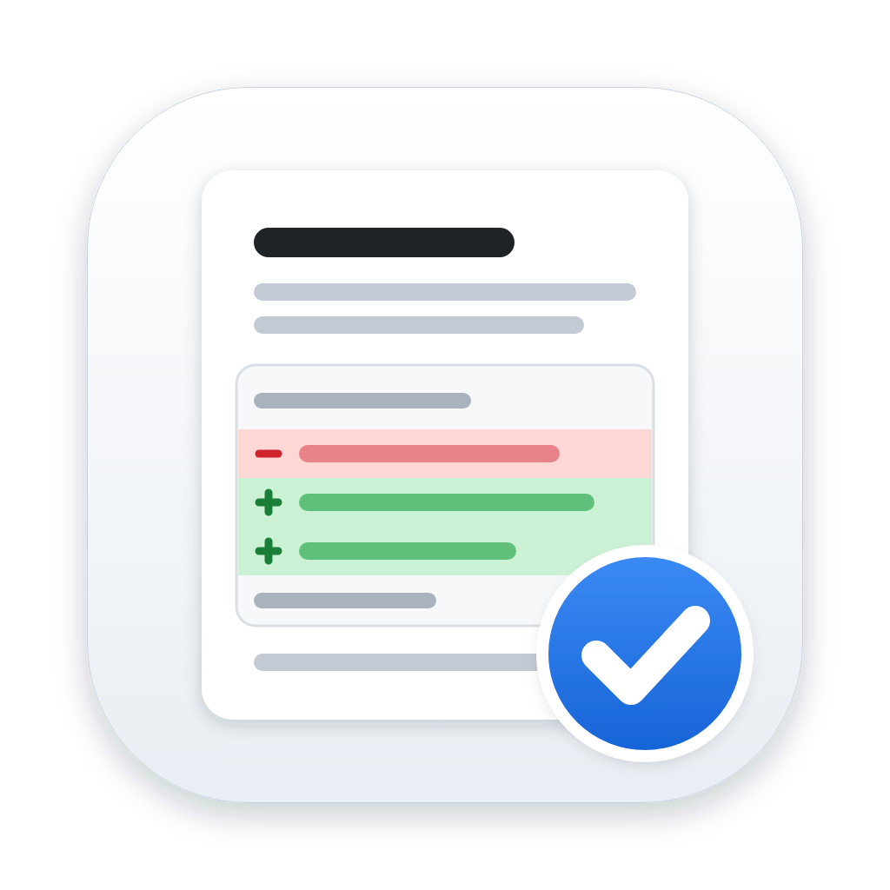
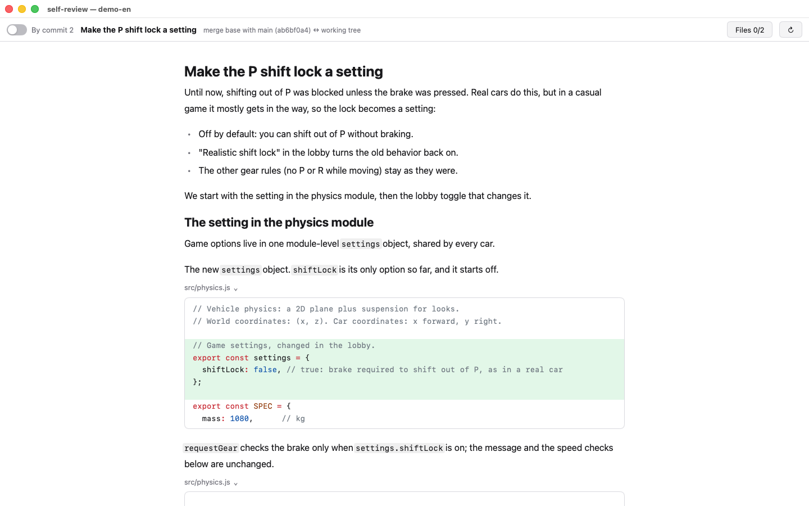

<p align="center"></p>

<h1 align="center">self-review</h1>

<p align="center">Review your own changes through a guide your coding agent writes, with the diffs inline. Everything stays on your machine.</p>



A plain diff shows a change file by file. A good explanation shows it in the order that makes sense: the intent first, then the entry point, then the pieces it calls, with only the lines that matter. self-review asks your coding agent (Claude Code, for example) to write that explanation as a short guide, and shows it in a native window next to the real diffs from your Git repository.

- **Local only.** No server, no port, no telemetry. The window is drawn natively from Go with [MyGo](https://mygo.run/); there is no web page or browser involved. Diffs come from your local Git.
- **Ask your agent.** Ask about the whole change, a section of the guide, or any lines (the **+** next to a line number), and read the answers next to the diff. Questions go to the coding agent you already use (Claude Code, Gemini CLI or Codex), read-only.
- **Nothing to clean up.** Closing the window ends the process.
- **Whole branch or one commit at a time.** Review a pull request as a whole, or step through its commits.
- **Viewed marks.** Tick files as you read them; editing a file makes it unread again.

## Install

### macOS app

Download `self-review-<version>-macos.zip` from [Releases](https://github.com/hashrock/self-review/releases), unzip it and open `self-review.app`. If it runs from outside Applications, it offers to move itself there. The app is signed and notarized.

The app is also the command-line tool, which agents run to check and open guides. Put it on your `PATH` with **Install Command-Line Tool** on the app's welcome window, or:

```sh
/Applications/self-review.app/Contents/MacOS/self-review install-cli
```

This links `self-review` into the first of `~/.local/bin`, `~/bin`, `/opt/homebrew/bin` and `/usr/local/bin` that is on your PATH and writable (else `/usr/local/bin`, asking for an administrator's password). The link points into the app, so updating the app updates the command.

Opening the app from Finder shows a window to drop a repository folder on, or to choose one with **Open Folder…**. Dropping another repository on a review window opens it in a window of its own.

### With Go

```sh
go install github.com/hashrock/self-review@latest
```

Requires Go 1.27 or later. On Linux the window needs GTK 3.

## Quick start

1. Install the agent skill (for Claude Code it goes to `~/.claude/skills/self-review`):

   ```sh
   self-review skill --install
   ```

2. In the repository you want to review, ask the agent:
   - `/self-review` for a guide to the whole branch (the pull request), or
   - `/self-review commits` for a guide per commit (only commits without one).

   The agent writes the guide, checks it with `self-review check`, and opens the window with `self-review open`.

3. Read. Click a file name to open it on the right, tick **Viewed** as you go, and switch between **Whole branch** and **By commit** at the top.

You can also run `self-review open` yourself at any time. Without a guide, the window shows every changed file's diff.

## Language

The window and the guides use the reader's language. By default it follows your system; set it with:

```sh
self-review config lang ja   # or en, or auto
```

The window is available in English and Japanese. Text meant for agents (the skill, `--help`, `check` output) is always English.

## Asking questions

The **💬 Questions** tab on the right holds conversations with your coding agent:

- **New question** asks about the whole change.
- **Ask about this section**, at the end of each section of the guide, asks about that section.
- The **+** next to a line number (in the guide or in a file) asks about that line, or about the lines you selected. The line then shows its conversation under it.

Type a question or a review comment and press ⌘↩. The first message of a conversation tells the agent what changed and what you are looking at; follow-ups continue the same conversation.

self-review talks to the agent through the [Agent Client Protocol](https://agentclientprotocol.com/), with the agent's own login:

```sh
self-review config agent claude   # default; also gemini or codex
```

| Agent | Started as | Needs |
| --- | --- | --- |
| Claude Code | `npx -y @agentclientprotocol/claude-agent-acp` | Node.js 22+, Claude Code signed in |
| Gemini CLI | `gemini --acp --approval-mode plan` | Gemini CLI signed in |
| Codex | `npx -y @agentclientprotocol/codex-acp` | Node.js, Codex signed in |

To run another ACP agent, set `"agentCommand"` in the config file (`self-review config --help` shows where) to its command line as a JSON array.

The agent is kept read-only: its session is switched to plan (or read-only) mode, self-review offers it no file writing or terminal, and any permission request other than reading or searching is refused. It starts at your first question and ends when you close the window.

Note that what you ask, and the code the agent reads to answer, goes to your agent's provider under your agreement with them, as when you use the agent directly. self-review itself sends nothing.

## How it works

The agent writes Markdown with three kinds of tags, saved under `.self-review/` in your repository (ignore it in Git):

```
<change-guide title="Make the P shift lock a setting" comparison="branch">
# Make the P shift lock a setting

Why the change exists, in a few lines.

## The setting in the physics module

<excerpt path="src/physics.js" start-line="4" end-line="7">
The new `settings` object.
</excerpt>

<related-location label="Car.requestGear" path="src/physics.js" start-line="22" end-line="32"/>

## Recap

What fits together, what is tested, what is left.
</change-guide>
```

A guide names files and line ranges only; self-review takes the actual diff from Git. `self-review check` verifies the paths and lines against the repository and warns when an excerpt grows past 30 lines, which keeps guides short.

| Scope | Compares | Guide |
| --- | --- | --- |
| Whole branch | the merge base with the base branch ↔ the working tree | `.self-review/guide.md` |
| One commit | the commit ↔ its parent | `.self-review/commits/<hash>.md` |
| Uncommitted changes | `HEAD` ↔ the working tree | `.self-review/commits/worktree.md` |

Viewed marks are kept in `.self-review/state.json`, keyed by the exact change of each file.

## Commands

```
self-review open [<dir>]     open the review window (returns at once; one window per repository)
self-review check [<path>]   check guides against the repository
self-review commits          list the commits under review and which have guides
self-review skill            print the agent skill (--install to install it)
self-review config           show or change settings (language, agent)
self-review help <command>   details of a command
```

Keys in the window: `R` reload, `C` show or hide Changes, `V` mark the open file viewed, `[` and `]` previous and next commit.

## Development

```sh
go test ./...

# Render the window to PNGs without opening it
SELF_REVIEW_REPO=/path/to/repo SELF_REVIEW_SHOTS=/tmp/shots go test ./internal/app -run TestRender

# Build, sign and notarize the macOS app (needs a Developer ID and a notarytool profile)
VERSION=0.1.0 NOTARY_PROFILE=<profile> scripts/build-mac.sh
```

- `internal/guide` parses and validates guides
- `internal/repo` reads diffs and files from Git and picks excerpt lines
- `internal/review` lists what can be reviewed and loads a guide with its changes
- `internal/app` is the window (MyGo native UI), testable headless with `ui.NewTester`
- `internal/agent` talks to coding agents over ACP, read-only
- `internal/state`, `internal/config` keep viewed marks and settings
- `skill/SKILL.md` is the agent skill
